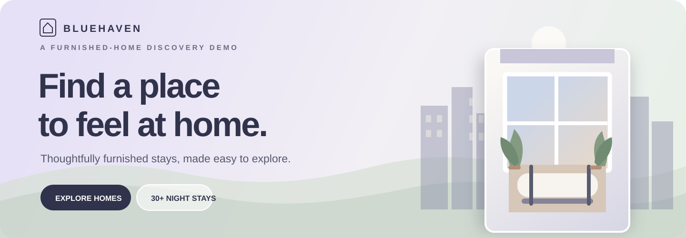
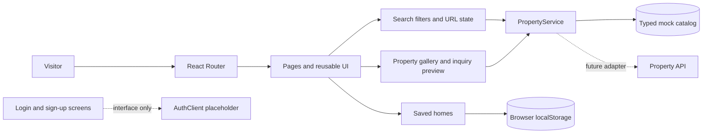

<div align="center">
  
  <br />
  <p><strong>A polished, responsive frontend for discovering furnished homes and flexible monthly stays.</strong></p>
  <p>Search by city and dates. Compare homes. Save favorites. Explore a complete booking journey—without pretending a backend exists.</p>
  <p>
    <a href="https://github.com/Skeeb32/bluehaven-furnished-homes/stargazers">⭐ Star the project</a> ·
    <a href="https://github.com/Skeeb32/bluehaven-furnished-homes/fork">🍴 Fork it</a> ·
    <a href="https://github.com/Skeeb32/bluehaven-furnished-homes/issues">💬 Open an issue</a>
  </p>
  <p>
    
    
    
    
    
    
  </p>
  <p><em>Independent frontend demo · Bluehaven is not affiliated with Blueground.</em></p>
</div>

---

## The idea

Finding a furnished place for a longer stay often means hopping between city guides, listings, availability, and details. **Bluehaven brings that discovery flow into one cohesive experience:** start with a destination and dates, refine the results, save homes, and explore each property's details.

This repository is a frontend-first product demo. It uses realistic, typed mock data and clear service boundaries so the UI works today and can be connected to a real property API later. The homes, availability, prices, locations, and imagery are illustrative; no booking, payment, inquiry delivery, or authentication service is connected.

## At a glance

| | Project facts |
|---|---|
| Destinations | Chicago, New York, Los Angeles, and Boston |
| Demo inventory | 24 typed mock homes across 4 destinations |
| Search | URL-backed destination and dates; bedroom, price, type, amenity, and sort controls |
| Stay rules | 30-night minimum with mock availability-window checks |
| Favorites | Saved in the browser with `localStorage` |
| Tests | 4 focused tests for filtering, sorting, and date rules |
| Live deployment | None configured; run locally with the steps below |
| License | No `LICENSE` file is currently included |

## Explore the experience

- **Home** — a furnished-home hero, destination search, city cards, service benefits, and FAQs.
- **Destination discovery** — city landing pages with local context and available demo inventory.
- **Search results** — compose filters, sort homes, remove active filters, and inspect a schematic map preview.
- **Property details** — browse a keyboard-friendly gallery, review specifications and amenities, select dates, and preview an inquiry.
- **Saved homes** — keep a local collection of favorites in the current browser.
- **Login and sign-up UI** — explore the designed screens; authentication is intentionally unavailable.
- **Responsive layout** — layouts adapt for mobile, tablet, and desktop, with keyboard focus states and reduced-motion support.

### Routes

| Route | Page |
|---|---|
| `/` | Homepage |
| `/destinations` | Destination collection |
| `/furnished-apartments-usa` | Destination collection alias |
| `/furnished-apartments-chicago-usa` | Chicago city page |
| `/furnished-apartments-new-york-usa` | New York city page |
| `/furnished-apartments-los-angeles-usa` | Los Angeles city page |
| `/furnished-apartments-boston-usa` | Boston city page |
| `/search?city=los-angeles&moveIn=2026-10-23&moveOut=2026-12-23` | Search results with URL-persisted query |
| `/properties/:id` | Property details and gallery |
| `/saved` | Saved homes |
| `/about` · `/corporate-housing` · `/contact` | Supporting pages |
| `/login` · `/signup` | Login popup and separate sign-up page |

The example dates above illustrate the query format. Search forms enforce a stay of at least 30 nights and results are checked against each mock home's availability dates.

## Architecture

The UI reads from a small service layer rather than depending on page-level property arrays. The current service resolves local mock data; replacing that implementation is the intended backend integration point.



### Where to look

| Path | Responsibility |
|---|---|
| `src/main.tsx` | Application shell and route definitions |
| `src/components/shared.tsx` | Header, footer, search form, cards, dialogs, and shared UI |
| `src/pages/` | Home, destination, search, property, account, and contact pages |
| `src/data/catalog.ts` | Typed destinations, amenities, imagery, and 24 mock properties |
| `src/types/index.ts` | Destination, property, search, and future auth contracts |
| `src/services/properties.ts` | Mock-backed list/detail services, date validation, filters, and sorting |
| `src/services/auth.ts` | Auth and inquiry interfaces with unconnected implementations |
| `src/services/properties.test.ts` | Search, sorting, availability, and date validation checks |
| `src/styles/global.css` | Design tokens, responsive layouts, and shared styling |

**Important boundary:** the `VITE_API_BASE_URL` setting is reserved for future integration. There are no API requests in this demo. `AuthClient` is a placeholder; it does not create accounts, manage sessions, or store passwords. Inquiry forms show a local preview and do not send data.

## Quick start

### Requirements

- Node.js 20 or newer
- npm (bundled with Node.js)
- An internet connection for the externally hosted Unsplash images and Google Font

### Run the app

```bash
git clone https://github.com/Skeeb32/bluehaven-furnished-homes.git
cd bluehaven-furnished-homes
npm install
npm run dev
```

Open the local URL printed by Vite (by default, `http://127.0.0.1:5173`). No environment file or API key is needed.

### Validate changes

```bash
npm run typecheck  # TypeScript check
npm test           # Focused search and date tests
npm run build      # Type-check and create the production bundle in dist/
```

To serve the built `dist/` directory, use a static host configured to send unknown paths to `index.html` so React Router routes can load on refresh. No deployment workflow or hosting provider is configured in this repository.

## Try a search

1. Open the homepage and choose a destination.
2. Select move-in and move-out dates at least 30 nights apart.
3. Select **Search**. Destination and dates are carried in the URL.
4. Sort the results or open **Filters** to refine by bedrooms, property type, monthly price, and amenities.
5. Open a home to view its mock details and gallery; use the heart icon to save it.

For example:

```text
/search?city=los-angeles&moveIn=2026-10-23&moveOut=2026-12-23
```

The map is a visual preview with illustrative pins, not a geocoded map. The sample dates are not promises of real availability.

## Engineering highlights

- **Typed domain model:** destinations, property details, filters, and future auth contracts are explicit TypeScript interfaces.
- **Replaceable data source:** pages call an async `PropertyService`; the current implementation can be swapped for an API adapter without moving property arrays into components.
- **Shareable search state:** destination, date, amenity, price, bedroom, type, and sort selections use query parameters where applicable.
- **Input and availability rules:** date ranges are validated for format, order, 30-night minimum, and mock inventory bounds.
- **Accessible interaction patterns:** semantic controls, named buttons, focus indicators, keyboard-operated gallery, dialog close behavior, and reduced-motion styling.
- **Explicit integration boundaries:** account and inquiry UI explains that services are not connected instead of simulating successful actions.
- **Focused automated checks:** tests cover composed filters, numeric sorting, invalid stays, and availability windows.

## Roadmap

### Available now

- [x] Responsive home and city discovery pages
- [x] Search with filters, sorting, query parameters, and empty states
- [x] Property details, gallery, and mock availability
- [x] Local saved homes
- [x] Inquiry preview and auth screens
- [x] Typed mock services and focused tests

### Possible next steps

- [ ] Add a real property and availability API adapter
- [ ] Add integration tests for routed search and gallery interactions
- [ ] Connect an inquiry service and add server-side validation
- [ ] Integrate an identity provider with secure session handling
- [ ] Replace illustrative map pins with authorized location data and a real map provider
- [ ] Add deployment automation and a live demo URL

These are proposals, not features currently implemented.

## Contributing

Ideas, bug reports, and focused pull requests are welcome.

1. Fork the repository and create a branch from `main`.
2. Install dependencies with `npm install`.
3. Make a focused change and keep mock/demo behavior explicit.
4. Run `npm run typecheck`, `npm test`, and `npm run build`.
5. Open a pull request with a clear description and screenshots for visual changes.

Please do not add real credentials, claim that a mock booking succeeded, or introduce an API call without documenting its contract and configuration. Open an issue first for larger changes so the direction can be discussed.

> **License status:** this repository does not currently include a license. Please check with the maintainer before reusing or redistributing its code until a license is added.

## For engineers and recruiters

Bluehaven demonstrates a complete frontend discovery flow built with React 19, TypeScript, Vite, and React Router: route composition, responsive UI, URL-synced search, typed mock services, filters and sorting, gallery state, browser-persisted favorites, accessible dialogs, and targeted tests. The key design decision is the boundary between presentation and the mock service, which keeps the app useful without a backend and gives future API integration a clear starting point.

**Current project scale:** 4 destinations · 24 mock homes · 6 amenities · 4 focused tests. This is a frontend demonstration; no production traffic, booking volume, performance benchmark, or connected backend is claimed.

## Join the next chapter

If this project is useful or gives you an idea, please ⭐ [star it](https://github.com/Skeeb32/bluehaven-furnished-homes/stargazers), 🍴 [fork it](https://github.com/Skeeb32/bluehaven-furnished-homes/fork), or [open an issue](https://github.com/Skeeb32/bluehaven-furnished-homes/issues). Contributions and thoughtful feedback are welcome.

<div align="center">
  <strong>Find a place to feel at home.</strong><br />
  <sub>Built as an independent frontend demo. Illustrative homes, prices, and availability only.</sub>
</div>
